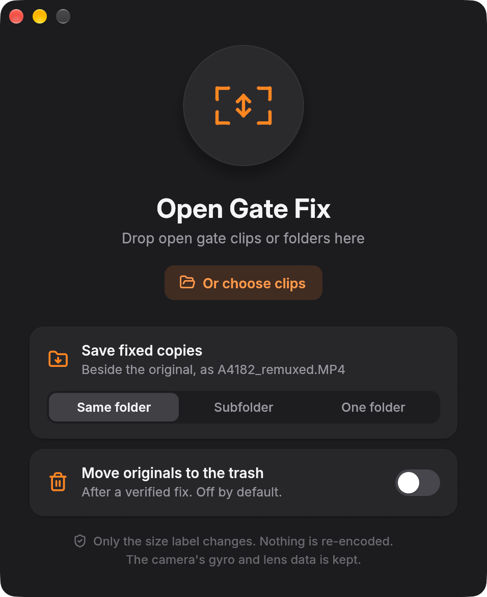

# Sony ZV-E1 Mods

**The mods and tools I use on my Sony ZV-E1.**

[Card-speed bypass](#card-speed-bypass) · [Open gate](#open-gate) · [Open Gate Fix app](#open-gate-fix-app) · [FAQ](#faq)

---

## What's here

| | What it is | Runs on | Download |
|---|---|---|---|
| [**Card-speed bypass**](#card-speed-bypass) | Record high-bitrate modes on fast cards the camera doesn't recognise. | macOS | [**macOS**](https://github.com/itsAllexB/sony-zv-e1-mods/releases/download/card-speed-bypass-v0.1.0/card-speed-bypass-macos-v0.1.0.zip) |
| [**Open gate**](#open-gate) | Full-sensor 3:2 recording. A separate project by ArcaneLantern; this page only links to it. | See his repo | [ArcaneLantern's repo](https://github.com/ArcaneLantern/zve1-open-gate-test) |
| [**Open Gate Fix app**](#open-gate-fix-app) | Fixes open gate clips so editors open them at the right size. | macOS, Windows, Linux | [**macOS**](https://github.com/itsAllexB/sony-zv-e1-mods/releases/download/open-gate-fix-v0.1.0/open-gate-fix-macos-v0.1.0.zip) · [**Windows**](https://github.com/itsAllexB/sony-zv-e1-mods/releases/download/open-gate-fix-v0.1.0/open-gate-fix-windows-v0.1.0.exe) · [**Linux**](https://github.com/itsAllexB/sony-zv-e1-mods/releases/download/open-gate-fix-v0.1.0/open-gate-fix-linux-v0.1.0.tar.gz) |

## Card-speed bypass

Lets you record high-bitrate modes like **4K 120p** and **4K 60p 600 Mbps**
on fast cards the camera doesn't recognise.

[**Download zip**](https://github.com/itsAllexB/sony-zv-e1-mods/releases/download/card-speed-bypass-v0.1.0/card-speed-bypass-macos-v0.1.0.zip)

> [!NOTE]
> The mod stays on until you take the battery out. Turning the camera off and
> on with the power switch keeps it. Pull the battery for a couple of seconds
> and the camera is exactly back to stock. Nothing is saved to the camera's
> firmware or settings.

### What you need

- A Sony **ZV-E1** on firmware **2.02** (check under *Setup → Version*)
- A Mac with Python 3.9 or newer
  (run `xcode-select --install` once if you don't have it)
- A USB-C **data** cable, plugged straight into the Mac
- A battery that's at least half charged

### How to run

**1. Download and set up** *(first time only)*

Download the zip from the [Card-speed bypass release](https://github.com/itsAllexB/sony-zv-e1-mods/releases/tag/card-speed-bypass-v0.1.0),
unzip it, open the `macos` folder and double-click **`setup.command`**.
Wait for *"Done. Setup complete."*

**2. Connect the camera**

Turn the camera off, set it to **Movie**, plug it into the Mac, then turn
it on.

**3. Run the mod**

Double-click **`card_speed_bypass.command`** and type your Mac password when
asked. The camera drops off USB for a few seconds and comes back. Wait for
**DONE**.

**4. Record**

Unplug and record.

### Undo

Pull the battery for a couple of seconds.

## Open gate

Open gate records the full sensor at **3840 × 2560** (3:2) instead of 16:9.

It is **not part of this repo**. It is made by **ArcaneLantern**, and you get
it, and its instructions, from his project:

**[ArcaneLantern/zve1-open-gate-test](https://github.com/ArcaneLantern/zve1-open-gate-test)**

How his kit (v2) behaves on a ZV-E1 with firmware 2.02, as tested here:

| | |
|---|---|
| XAVC HS 4K at 24p | Works, records 3840 × 2560 |
| 60p | Crashes when recording starts |
| Live view | Sometimes turns purple after applying |
| Tracking frame | Looks stretched |
| Clips in an editor | Open as 16:9 until fixed, see the app below |
| After turning the camera off and on | Open gate stops working, but part of it stays in memory. Pull the battery before recording normally, then apply it again |

Like the mod here, it only lives in the camera's memory and a battery pull
removes it. I've proposed a change to his kit that makes the camera label the
clips correctly by itself
([pull request](https://github.com/ArcaneLantern/zve1-open-gate-test/pull/2));
until that is in, use the app below. Questions and bug reports about open gate belong in his repo.

## Open Gate Fix app

Open gate clips are recorded at **3840 × 2560**, but the camera still labels
them 3840 × 2160, so editors like DaVinci Resolve open them as 16:9.
**Open Gate Fix** is a small app that corrects the label. Drop your clips on
the window and it saves fixed copies.

  

| System | Download |
|---|---|
| macOS (Apple silicon and Intel) | [**open-gate-fix-macos-v0.1.0.zip**](https://github.com/itsAllexB/sony-zv-e1-mods/releases/download/open-gate-fix-v0.1.0/open-gate-fix-macos-v0.1.0.zip) |
| Windows (64-bit) | [**open-gate-fix-windows-v0.1.0.exe**](https://github.com/itsAllexB/sony-zv-e1-mods/releases/download/open-gate-fix-v0.1.0/open-gate-fix-windows-v0.1.0.exe) |
| Linux (x86-64) | [**open-gate-fix-linux-v0.1.0.tar.gz**](https://github.com/itsAllexB/sony-zv-e1-mods/releases/download/open-gate-fix-v0.1.0/open-gate-fix-linux-v0.1.0.tar.gz) |

- Nothing else to install. It is one file and works offline.
- Nothing is re-encoded. Only the size label changes, and the camera's gyro
  and lens data is kept.
- Your originals are left alone unless you turn on *Move originals to the
  trash* yourself.
- You choose where the fixed copies go: next to the originals, in a
  `remuxed` folder, or in one folder for everything.
- Normal 16:9 clips are recognised and skipped.

The app isn't signed with a paid developer certificate, so the first launch
may need an extra click: on macOS right-click the app and choose **Open**; on
Windows choose **More info → Run anyway** if SmartScreen appears.

How it works and how to build it: [`opengate-fix/`](opengate-fix/README.md).

## FAQ

<b>Is this safe for my camera?</b>

 
The mod changes the camera's working memory only. Nothing is written to the
firmware, the menus or the saved settings, and a battery pull always puts
the camera back to stock. To get there, the Mac hands the camera a small
helper file to load; that file is deleted from the camera again as soon as it
has run. Before changing anything, the mod checks that it
is looking at a stock 2.02 camera. If anything doesn't match, it stops and
leaves the camera alone.

<b>Does it work on other firmware or other cameras?</b>

 
No. ZV-E1 on firmware 2.02 only. On anything else the mod refuses to run.

<b>Why does it ask for my Mac password?</b>

 
macOS needs admin rights to take the camera over from its own USB driver.
The password goes to macOS, not to the mod.

<b>The card-speed mod is on but recording still stops.</b>

 
The mod removes the camera's speed-class check. It can't make a card faster.
If the card really can't keep up with the bitrate, recording will still fail.
Use a faster card or a lower bitrate.

<b>Do I have to re-run it every time?</b>

 
Only after the battery has been out: the camera then starts up stock.
Turning it off and on with the power switch keeps the mod.

<b>Something went wrong. What now?</b>

 
Pull the battery for a couple of seconds. That always resets everything. Then run
<code>check_readonly.command</code> to make sure the Mac can see the camera.
It reads only and changes nothing.

## Credits

- Made by **[itsAllexB](https://github.com/itsAllexB)**
- [**Sony-PMCA-RE**](https://github.com/ma1co/Sony-PMCA-RE) by ma1co (MIT),
  bundled for connecting to the camera from macOS
- Open Gate Fix uses [**egui**](https://github.com/emilk/egui), the
  [**Inter**](https://rsms.me/inter/) typeface (OFL) and
  [**Lucide**](https://lucide.dev) icons (ISC)
- The camera connection method comes from **ArcaneLantern's** open-gate kits

## License

[MIT](LICENSE). Use at your own risk.
