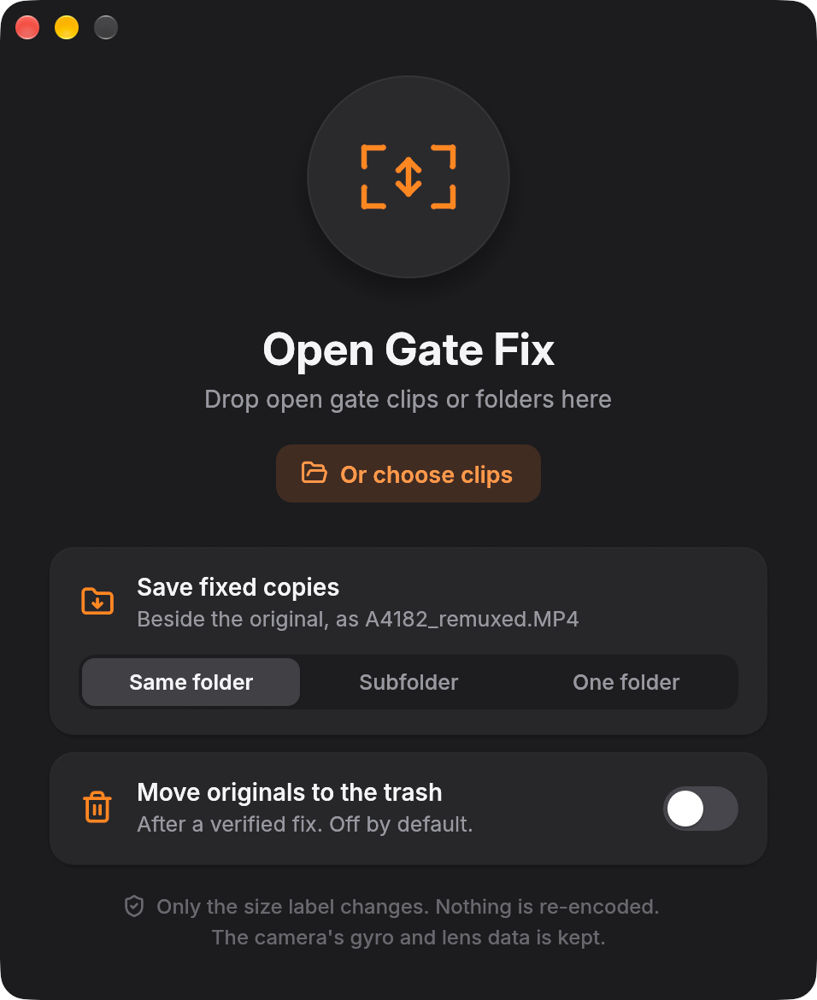

# Open Gate Fix

A small drag-and-drop app that makes open gate clips open at their real size.

<p align="center">
  
</p>

Open gate clips from a ZV-E1 running [ArcaneLantern's open gate mod](https://github.com/ArcaneLantern/zve1-open-gate-test) are recorded at 3840×2560, but the camera
still labels them 3840×2160 in the file header. Editors such as DaVinci Resolve
trust the label and show the clip as 16:9. Drop the clips on this app and it
writes copies whose label matches the picture.

One file per platform, nothing else to install (no ffmpeg, no runtime).

## Using it

1. Open the app.
2. Drop clips or whole folders anywhere on the window (or click "Or choose clips", or press Cmd/Ctrl+O).
3. The window turns into a list: each clip shows `Fixed`, `Skipped` (the label was already right)
   or `Failed`, with a progress ring while it is being copied. "Clear" removes finished rows.

**Options** (shown under the drop area when the window is empty; once there are results they are
behind the gear button, or Cmd/Ctrl+,)

| Option | Default | What it does |
|---|---|---|
| Save fixed copies: Same folder | on | Saves `A4182_remuxed.MP4` beside `A4182.MP4` |
| Save fixed copies: Subfolder | | Saves `remuxed/A4182.MP4` beside the original |
| Save fixed copies: One folder | | Saves every fixed clip into a folder you pick |
| Move originals to the trash | off | After a verified fix, the original and its XML go to the trash |

The Sony sidecar file (`…M01.XML`) is copied and corrected along with the clip.
An existing output file is never overwritten.

## What it changes

It is not a remux. The clip is copied and four header fields are corrected in the copy:

| Place | Field |
|---|---|
| `moov/trak/tkhd` | track display size |
| `stsd` sample entry (`hvc1`/`avc1`) | coded size |
| Sony `uuid PROF` → `VPRF` | profile size |
| `meta/xml` NonRealTimeMeta | `videoCodec`, `numOfVerticalLine`, `aspectRatio` |

The real size is read from the video stream's own parameter set (SPS), so a
clip is only touched when its label and its stream disagree. For a test clip the copy
differs from the original in 11 bytes; video, audio and the `rtmd` metadata
track (gyro, accelerometer, lens data) are byte-identical.

### Compared with the ffmpeg remux

`ffmpeg -c copy -map 0:v -map 0:a` also fixes the size, but it drops the `rtmd`
track, so Gyroflow or Catalyst Browse can no longer stabilize from that file.
This app keeps the track.

## Tested

| Check | Result |
|---|---|
| Two open gate clips (XAVC HS 4K 24p) | fixed, DaVinci Resolve 21 imports as 3840×2560 |
| A stock 16:9 clip | skipped, untouched |
| Video / audio / `rtmd` streams, original vs fixed | identical (MD5) |
| Embedded metadata incl. per-frame accelerometer (exiftool) | identical apart from the size fields |
| Gyroflow / Catalyst Browse with a fixed file | **not tested yet** |
| XAVC S (H.264) open gate clip | **not tested** (no sample; parser checked on a synthetic H.264 file) |
| macOS, Windows and Linux builds | run on all three, no issues |

## Building

```bash
cargo build --release              # this platform
./scripts/bundle-macos.sh          # macOS universal .app (with icon) + zip in dist/
```

The window has no visible title bar. On macOS the traffic lights stay and the
content runs under them. On Windows and Linux the app draws its own minimise /
close buttons and resize edges, and the top strip drags the window. The window
size is limited (420×560 to 560×860), so there is no maximise or full screen.

Fonts and icons are embedded, so the binary still needs nothing else:

| File | What | Licence |
|---|---|---|
| `assets/fonts/Inter-subset.ttf` | [Inter](https://github.com/rsms/inter) 4.0 variable, Latin/Greek/Cyrillic subset | SIL OFL 1.1 (`assets/fonts/LICENSE-Inter.txt`) |
| `assets/fonts/lucide-subset.ttf` | the ~20 [Lucide](https://lucide.dev) 1.79 icons the UI uses | ISC (`assets/fonts/LICENSE-Lucide.txt`) |
| `assets/AppIcon.icns`, `assets/icon-256.png` | app icon, drawn by `scripts/make-icon.py` | this project |

To use another Lucide icon, add its code point to `scripts/subset-fonts.sh` and
`mod icon` in `src/gui.rs`, then rerun the script (needs `pip install fonttools`).
`cargo test` fails if any text or icon the UI draws is missing from the fonts.

The workflow `.github/workflows/opengate-fix.yml` builds all three platforms when a tag `open-gate-fix-v*` is pushed, and attaches them to a draft release.
The macOS app is ad-hoc signed, so on another Mac the first launch needs
right-click → Open.

`opengate-fix --cli <files or folders>` runs without a window, using the saved settings.
